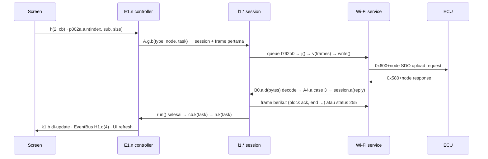

# aRacer X Tune 3.7.2 — arsitektur aplikasi (MiniX & Mini XX)

Hasil analisis statis APK `com.aracer.skycal` 3.7.2 (REA 6.7.0 + jadx 0.7.1), 2026-10-21.
Tidak ada yang diamati di HP/ECU nyata. Nama kelas hasil obfuscation dipertahankan supaya
bisa dicari langsung di `decompiled/sources`.

Scope: RC MiniX (family 1, serial `A6…`, node 1) dan RC Mini XX (family 33, serial `B6…`, node 33).

## 1. Lapisan dan aliran data

```mermaid
flowchart TB
  subgraph UI
    DB[Dashboards<br/>Simple · Race · Cube]
    CAL[Calibration screens<br/>D1 / D3 / D1x4 / wizard]
    TOOLS[Tools<br/>QuickBurn · Power test · Logs]
    STAT[Status & store<br/>ECU state · Activation · Service]
    BUS[(EventBus D7.d<br/>H1.c / H1.d / H1.e)]
  end
  MENU[Feature menu Fragment_CalItems<br/>table IDs + license bit per item, gating D1.a]
  subgraph CONTROL
    N[Bus controller E1.n<br/>task queue · handshake · watchdog 6 s · k() result dispatch<br/>ECU state k1.b]
    W[Monitor / logger E1.w<br/>parses PDO stream, writes CSV, feeds gauges]
    DEF[Definition store p1.d<br/>ControlFile_*.dat (AES) · ScaleData.xml · templates]
    CLOUD[Cloud<br/>aracercustomer.com/api · Play Billing · Firebase · file CDN]
  end
  subgraph PROTOCOL
    FAC[Session factory A.g.b type,node,task<br/>26 task types]
    SES[Command sessions l1.e c d j b k m<br/>state machine: reply → next frames]
    SDO[SDO builder m1.a<br/>0x600+node · expedited + block]
  end
  subgraph TRANSPORT
    SVC[aRacerWiFiCANService<br/>TCP 192.168.88.88:6666 · envelope F8 01 C0 + checksum]
    USB[USB Pro-Link z1.e<br/>CDC-ACM, envelope sama]
  end
  subgraph HARDWARE
    BR[Wi-Fi CAN bridge<br/>AP · TCP ↔ CAN transparan]
    ECU[ECU CANopen slave<br/>node 1 MiniX · node 33 Mini XX]
  end
  CAL --> MENU --> N
  DB --> N
  TOOLS --> N
  DEF -->|table id → index 0x3000+id| N
  N -->|posts task h type| FAC --> SES --> SDO --> SVC
  SDO --> USB
  SVC <-->|TCP bytes| BR <-->|CAN| ECU
  ECU -.->|PDO 0x180+node| W
  W -.-> DB
  N -.->|state events| BUS -.-> UI
  CLOUD -.-> STAT
```

## 2. Pipeline satu task

Setiap operasi ECU adalah task `k1.d` dengan type: 1 identify, 2 read, 3 write, 4/5 stream
pause/start, 16 identity sweep, 18/19 load tables, 21 key, 23 QuickBurn, dst. Satu sesi
berjalan pada satu waktu, timeout 4,5 s per langkah, tidak ada retry.



Status: 255 selesai, 253/254 gagal, 226 timeout. Read ≤ 4 byte = satu request satu reply.
Read tabel = block upload (0xA4 → 0xA3 → segmen → 0xA2 → 0xA1) di dalam sesi yang sama.

## 3. Katalog fitur MiniX & Mini XX

Menu kalibrasi dibangun runtime oleh `Fragment_CalItems`. Tiap item membawa screen tujuan,
bit lisensi, dan daftar table ID. **Index CANopen tabel = table ID + 0x3000**
(`q1.d.f12380h = id + 12288`), **variabel live = ID + 0x4000**. Jadi peta index diketahui
walau layout tabel tetap di file definisi terenkripsi.

Legenda: `bit n` = bit lisensi ECU_Fun (0x1018:11) penomoran MiniX · `XX` = hanya Mini XX ·
`cond.` = syarat firmware/koneksi tambahan.

| Fitur | Screen | Lisensi | Table ID → index | Catatan |
|---|---|---|---|---|
| **Fuel** | | | | |
| Fuel base map | nav_cal_d1 | bit 0 | 19 → 0x3013 | tabel fuel utama |
| Fuel adjust 3D | nav_cal_d3 | bit 2 | 4 → 0x3004 | |
| Acceleration fuel | nav_cal_d3 | bit 1 | 21 → 0x3015 | |
| Injection angle | nav_cal_d3 / nav_cal_d3_inj_angle | bit 4 | 61 → 0x303D | Mini XX pakai screen khusus |
| Temperature comp | nav_cal_d3 | bit 5 | 41 → 0x3029 | |
| Fuel compensation | nav_cal_d1x4 | bit 5 | 1005 1006 1007 | |
| Target AFR | nav_cal_d3 | bit 8 | 54 966 933 | |
| DFCO | nav_cal_d1 | bit 1 | 22 → 0x3016 | |
| Injector calibration | nav_injector_calibration | bit 1, XX | 72 → 0x3048 | SKU Mini XX bit 16 |
| **Spark** | | | | |
| Spark angle 3D | nav_cal_d3 | bit 3 | 133 967 150 | |
| Backfire | nav_cal_backfire | bit 6 | 40960–40964 | region vendor 0xA000 |
| **Engine** | | | | |
| Idle RPM | nav_cal_d1 | bit 1 | 20 → 0x3014 | |
| Idle air adjust | nav_cal_idleadj | — | 0x200000 (command) | live, bukan tabel |
| RPM limit | nav_cal_d1 | bit 1 | 8 → 0x3008 | |
| VVA | nav_cal_d1 | bit 1 | 37 → 0x3025 | hanya MiniX/Mini XX (`D1.a.c()`) |
| Auto-tune | nav_cal_autotune | bit 7 | 14 → 0x300E | SKU Mini XX "AutoTune2" bit 3 |
| Wideband O2 closed loop | nav_cal_d1 | bit 7 | 1059 → 0x3423 | eksklusif dgn NB CL, AT, idle loop (`n.u()`) |
| Narrowband O2 closed loop | nav_cal_d1_nb_cl | bit 9, cond. | 60 842 | hanya firmware 02_35, 02_29, dll |
| Power estimation | nav_cal_d3 | bit 15 | 1309 → 0x351D | SKU Mini XX "RealTimePower" bit 5 |
| High idle | nav_cal_d1x4 | bit 16 | 1311 1294 | |
| Auto warm-up | nav_cal_d1_auto_warmup | — | 1065 → 0x3429 | muncul di cabang offline; verifikasi di hardware |
| **Vehicle** | | | | |
| Speed gain | nav_cal_d1 | bit 1 | 33 → 0x3021 | |
| Fan control | nav_cal_d1 | bit 1 | 28 → 0x301C | |
| Launch control | nav_cal_d1x4 | bit 10 | 1150 6 11 123 | |
| Pit limiter | nav_cal_d1x4 | bit 11 | 1010 7 131 | |
| TPS learn | nav_cal_tps_learn | — | 0x200100 (command) | prosedur |
| Ride-mode matrix (R button map) | nav_rbutton_setting | bit 14 | 1046 1047 1049–1054 1056 | SKU Mini XX "RideModeMatrix" bit 4 |
| Traction control | nav_cal_d1x5 | bit 13 | 1067 1127 138 1128 136 | |
| Traction control Plus | nav_cal_d1x4 | bit 18, cond. | 1408 136 | firmware harus ada di daftar TCS+ |
| Service interval | nav_vehicle_service | bit 20 | 8207 → 0x500F | tampil jika `D1.a.f471y` |
| eBoost | nav_eboost_option / nav_eboost_x2_ecu | — | 1230 1202 1418 1391 (+1566–1568 XX) | SKU Mini XX "YAMAHA eBoostAdv" bit 8 |
| eCVT AT/MT | nav_cal_ecvt_at / _mt | XX, cond. | 1533–1536 1549 1550 1578 | byte table-ID harus 61 |
| Windshield | nav_wind_shield | XX, cond. | 1009 1133 | firmware mulai 01_76 |
| **Accessory** | | | | |
| Quickshifter wizard/setting/cut time | nav_qs_wizard / nav_cal_qs_setting / nav_cal_d3 | bit 12 | 29 9 10 · 1132 | |
| AF2 heater | nav_cal_d1 | — | 1283 → 0x3503 | aksesori wideband |
| EXUP | nav_exup_setting | bit 17 | konstanta p002a.a | bit 17 MiniX, bit 13 Mini XX |
| R button | nav_r_button_setting | — | konstanta p002a.a | |
| RGB LED | nav_rgb_light_effects | bit 7, XX | — | SKU Mini XX "ECUDynamicLED" bit 7 |

### Section di luar kalibrasi

| Section | Nav id | Kelas | Fungsi |
|---|---|---|---|
| Dashboards | nav_simple_monitor · nav_race_monitor · nav_cube_monitor | Fragment_DB_*, gauge.* | gauge live dari monitor; MAP_Switcher ganti ride mode; TrialTimer |
| Calibration | nav_calitems | calselection.* | katalog di atas |
| Logs & iView | nav_loglist · nav_iview | LogFileList_Fragment, iView_Fragment | replay CSV di SciChart; iView berbayar (`mx_iview_upgrade`) |
| Power test | nav_powertest | Fragment_PowerTest, PTest_Pattern, RecordHandle, VehicleProfile, 2 report activity | akselerasi & kurva power dari log; GPS HP jadi pseudo-variabel −9000…−9003 |
| QuickBurn | nav_qb_form | Fragment_QB, p168x2.C0583o, l1.b/k/h/i | unduh paket map dari CDN (zip + MD5), burn via opcode vendor 0x32/0x34/0x36; tier advanced `mx_qb_advanced` |
| Map store | nav_mapstore | MapStore_Fragment | kalibrasi tersimpan, import/export (ImportFile_Activity) |
| Malfunction codes | nav_malfcode | Fragment_MalfCode | DTC dari ECU |
| ECU state | nav_ecustate | Fragment_EcuState | daftar fungsi owned/trial/buy per model |
| Activation | nav_ecu_activation | Fragment_EcuActivation, qrcode.* | scan QR, round-trip server, unlock ditulis ke ECU |
| System information | nav_sys_information | Fragment_SysInformation, UpgradeCardView | versi firmware, bit fungsi, update bridge & aksesori |
| Connect | nav_set_wifi | Select_ECU_Fragment, Activity_EcuTypeSwitch | pilih target Wi-Fi / USB, simpan calibration key per ECU |
| Settings | nav_appsetting | Fragment_Setting | satuan, bahasa, consent |

## 4. Data definisi

MiniX memuat `ControlFile_S3.dat` + `Default_AMX_Template.dat`; Mini XX memuat
`ControlFile_X2.dat` + `Default_AMX2_Template.dat` (parser `p1.d.k()` vs `i()`). Versi baru
diambil dari `file.aracercustomer.com`. File terenkripsi AES-CBC (kunci di native lib),
tidak didekripsi. Layout record di bawah berasal dari parser-nya.

**Record tabel (`q1.d`)**: [0] id (index = id+0x3000) · [1] rows [2] cols (0/0 = skalar "D1",
cols 0 = "D2", lainnya "D3") · [3] ukuran byte per sel · [4]–[7] nama sumbu & referensi skala
ke ScaleData.xml · [8][9][10] max, min, default · [11][12] gain, offset · [14] unit ·
[15] kelas penyimpanan (EEPROM dilewati saat bulk load) · [17] flag hex.

**Record variabel (`q1.f`)**: [0] id (index = id+0x4000; tipe "BitN" dilipat ke id negatif) ·
[1] ukuran · [2][3] gain, offset · [4][5] max, min · [6] tipe · [7] unit · [8] group
(Stage_1, Stage_2, Phone_GPS) · [9] desimal · [10] slot monitor.

`ScaleData.xml` plaintext: 11 sumbu RPM (5–17 breakpoint), plus TPS, MAP, suhu, speed.
Tabel 1016 = versi definisi yang diharapkan ECU.

## 5. Live data, log, dashboard

- Start/stop: SDO write `0x1800:5` = 64 ("nick_LogRestart") / 0 ("nick_LogPause").
- Stream: TPDO `0x180+node`; byte 0 = sequence, bit 7 = frame terakhir. `E1.w` gabungkan
  frame, baca daftar variabel monitor (group 26) u8/u16/u32 LE, terapkan gain/offset, konversi satuan.
- Konsumen: view yang implement `K1.b` daftar lewat `E1.w.f()` (gauge, 3 dashboard, power test, trial timer).
- Log: header `<VAR GROUP>` / `<VAR NAME>` (kolom "Time" pertama), lalu sampel CSV.
- Watchdog: heartbeat `0x700+node` reset hitung mundur 6 s.

## 6. Lisensi, trial, aktivasi

Gating fitur dipaksa oleh ECU dan dicerminkan di app. Saat connect dibaca `0x1018`:
sub 11 ECU_Fun, 12 Trial_Fun, 13 Factory_Fun, 14 order SN, 15/17/18 status & timer trial,
Mini XX sub 19–22 timestamp aktivasi, flag, run-time. `Fragment_EcuState` mengharapkan
`ECU_Fun == Factory | Trial`.

**Bit MiniX**: 0 FuelBase · 1 EngVehSetting · 2 Fuel3D · 3 Spark3D · 4 InjAngle · 5 FuelComp ·
6 BackFire · 7 AutoTune · 8 TagAFR · 9 NBCLC · 10 LaunchControl · 11 PitLimit · 12 QuickShifter ·
13 TSC · 14 RButton · 15 HPower · 16 HighIdle · 17 ExupD3Control · 18 TSCPlus · 20 ServiceInterval.

**Bit Mini XX**: 0 EngVehSettings · 3 AutoTune2 · 4 RideModeMatrix · 5 RealTimePower ·
6 ServiceAlert · 7 ECUDynamicLED · 8 YAMAHA eBoostAdv · 9 InjectionTiming · 10 BackFire_Motion ·
12 NBO2CL · 13 EXUP · 14 TractionPlus · 16 InjectorCal. Sisanya termasuk ECU dasar.

Jalur beli/aktivasi: Google Play Billing (`BillingController`) → server
`aracercustomer.com/api/` (`ecu-funpay`, `ecu-subscription`, `req-service-activation`,
`get-upgrade-status`, `get-upgrade-number`, `get-subscription-number`, di balik reCAPTCHA +
Firebase auth) → blob unlock dikirim dengan opcode vendor `0x94`/`0x9C` di `0x680`,
dijawab `0x95`/`0x9D`. Aktivasi offline menyimpan timestamp di `0x1018:19`.
Calibration key (24-bit desimal, default 888888) terpisah dari lisensi; gating akses tulis.

## 7. Subsistem lain

- **Firmware update**: firmware bridge di APK (`AccBin/BIN_WiFi*.bin`), firmware aksesori
  AF2/AF3 dari CDN (versi + MD5 di `D1.a`). Keduanya flash lewat sesi "SOF" `l1.j`
  (opcode 0x40, 0x42, 0x44, 0x46, 0x80, 0x70). Dialog "WiFi Ver. Upgrade" memaksa ini bila
  versi bridge lebih tua dari yang diminta ECU.
- **Help**: PDF per fitur dua bahasa di `assets/DesFiles`, dirender pdf.js.
- **QR**: CameraX + ML Kit untuk kode aktivasi dan kredensial Wi-Fi bridge (`p168x2.H`).
- **Analytics/ads**: Firebase Analytics dengan login servis hard-coded di native lib; daftar iklan dari CDN.
- **Terms**: notice risiko tuning & consent data dari CDN.

## 8. Peta package

| Package | Peran | Kelas kunci |
|---|---|---|
| com.aracer.skycal | UI | MainActivity, SkyCalApplication, navfragment.*, gauge.*, ui.* |
| com.aracer.aracerports.service | transport Wi-Fi | aRacerWiFiCANService |
| com.aracer.aracerlib | billing | BillingController |
| E1 | bus controller, monitor, helper server | n, w, m, a/b, o |
| A | session factory | g.b() |
| l1 (p085l1) | command sessions | e identify · c read · d write · j SOF · b/k/h/i QuickBurn · m multi-frame |
| m1 (p093m1) | SDO builder | a |
| k1 (p077k1) | ECU state & task | b, d, c, a |
| z1 (p181z1) | CAN msg, target, USB | a, d, e |
| p1 (p111p1) · q1 (p119q1) | definition store & model | p1.d · q1.d · q1.f · q1.g · q1.e |
| D1 | config global, gating model, URL CDN | a, b |
| H1 · D7 | event & EventBus | H1.c/d/e/i · D7.d |
| B1 · B0 · A4 · A1 | lambda/listener hasil split jadx | B0.a frame listener · A4.a reply dispatch |
| G1 · C1 | updater firmware | G1.a, C1.a |
| x2 (p168x2) | dialog | H QR · C0583o QuickBurn · Q upgrade bridge |
| n1 · x (p165x) | prefs, crypto, util | n1.a/b, AbstractC0521c (encoder envelope) |
| third party | SciChart, Firebase, Play Billing, ML Kit, CameraX, usb-serial-for-android, OkHttp, Glide, EventBus, coroutines, pdf.js | |

## 9. Yang belum diketahui

- Layout tiap tabel (baris, kolom, skala): di file definisi terenkripsi. Index diketahui, bentuk belum.
- String gating firmware persis untuk NB CL dan TCS+ di luar prefix yang dikutip.
- Opcode vendor `0xAE`, `0xBE`, `0xFA`, `0xFC`, dan handler CAN ID `0x6A9`.
- Perilaku runtime: timing, retry bridge, respons ECU ke frame rusak. Packet capture di MiniX nyata yang menjawab.
- Nomor bit lisensi di menu memakai tabel MiniX; Mini XX punya bit berbeda dan mana yang dipakai menu untuk family 33 belum ditelusuri.

File pendamping: `PROTOCOL.md` (wire protocol), `aracer_client.py` (PoC client), `decompiled/` (jadx tree lengkap).
