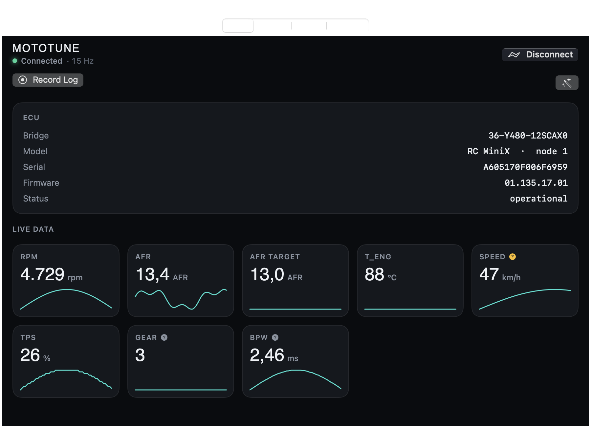
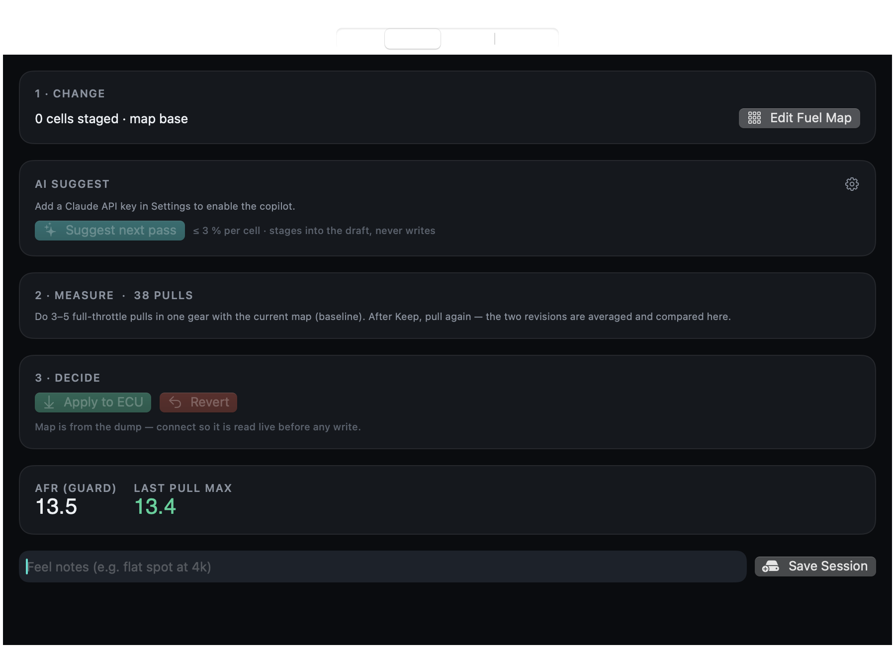
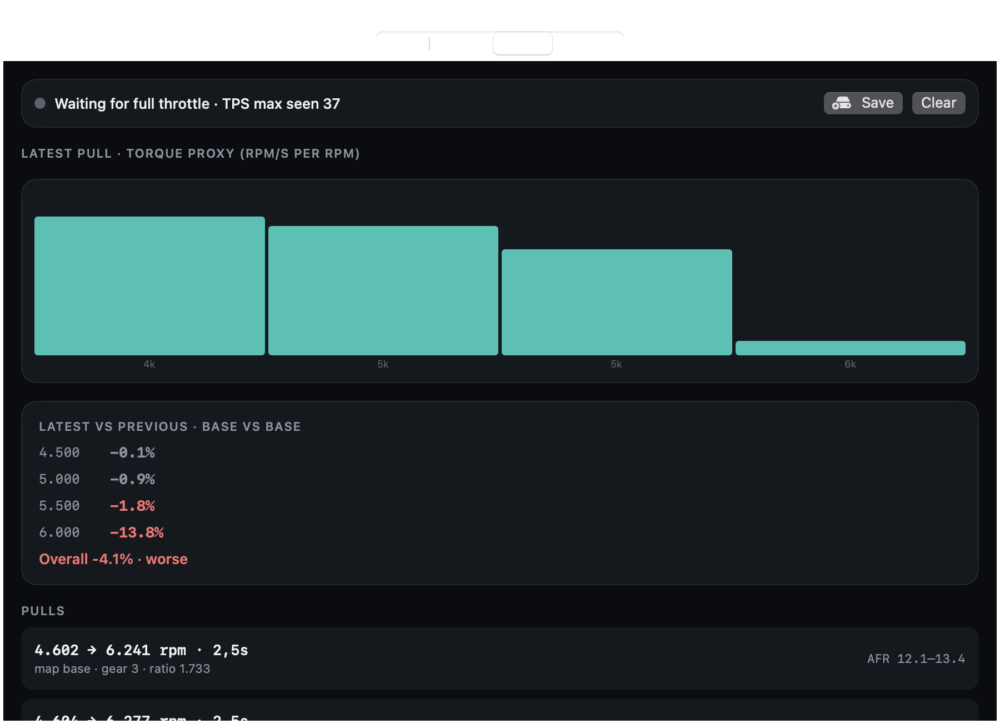
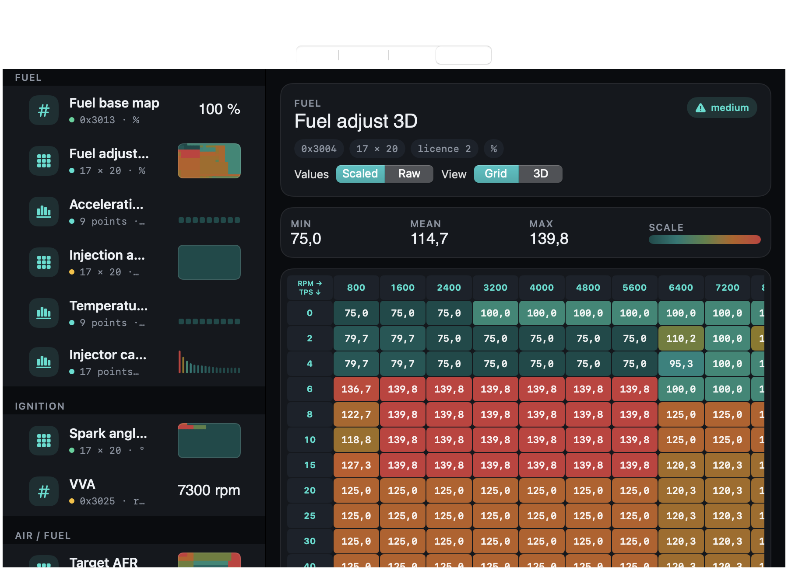
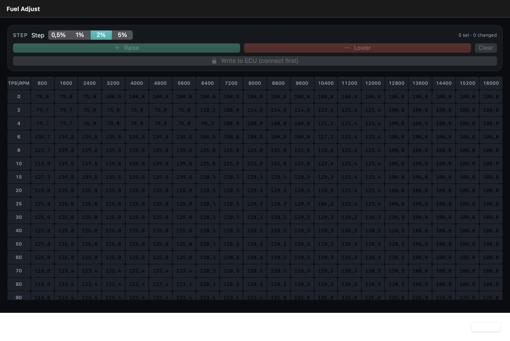
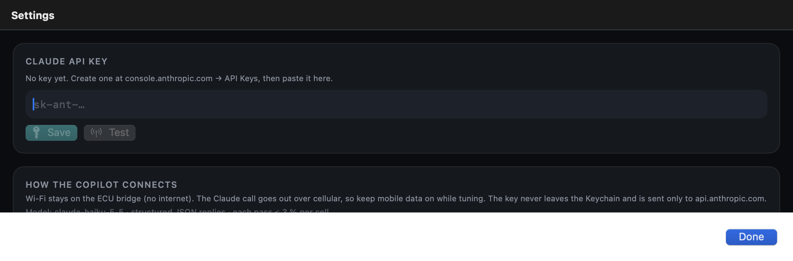

# MotoTune — status proyek

_Diperbarui 2026-10-22. App iOS pribadi untuk aRacer RC MiniX: koneksi langsung ke ECU, logging, dan copilot tuning berbasis performa terukur._

Repo: `~/Documents/Projects/aracer-xtune-re` — `ARacerKit/` (library + CLI + dashboard macOS), `iOSApp/` (MotoTune), `PROTOCOL.md`, `field-data/`, `dumps/`.

---

## 1. Sudah selesai dan terbukti di hardware

| Area | Status | Bukti |
|---|---|---|
| Protokol bridge Wi-Fi (TCP 6666, framing 19 B, CANopen SDO/PDO) | ✅ | dump penuh 1494 tabel + 1665 variabel dalam ~100 s |
| Aturan yang tidak tertulis di dokumen vendor: SDO harus DLC 8, balasan block-end tanpa index, NMT start sebelum TPDO, mapping 0x1A00 dulu, stream **big-endian** | ✅ | `PROTOCOL.md` § Verified on hardware |
| iPhone ↔ ECU langsung lewat Wi-Fi bridge, seluler tetap untuk internet | ✅ | koneksi stabil, auto-reconnect |
| Dump read-only pipelined (Python) | ✅ | `ecu_dump.py`, `dumps/2026-10-21-*` |
| Identifikasi variabel live tanpa file terenkripsi: RPM 26, AFR 55, AFR Target 774, T_Eng 33, TPS 369, Speed 51 | ✅ | snapshot-diff (fitur Identify) + log ride |
| Geometri tabel: semua grid **17 TPS × 20 RPM** (0–100 × 800–16000), Fuel Adjust dikonfirmasi pemilik | ✅ | dump + screenshot app resmi |
| Skala tabel: Fuel base/adjust ×100/128, AFR ÷10, Spark ÷10 | ✅ | cocok angka app resmi |
| Logging latar belakang (HP terkunci), biner 14 B/sampel ≈ 0,8 MB/jam, batch 8 KB | ✅ | `motolog-*.bin` + sidecar JSON |
| Sesi tetap hidup saat HP terkunci (tuner, dyno, reconnect, AI) | ✅ | keep-alive audio senyap seumur sesi |
| Design system gelap (Space Grotesk, cyan `#25E0D0`), semua teks UI Inggris, logo app | ✅ | — |
| Tab Tables: grup per fungsi, thumbnail heatmap, skalar/boolean/vektor/grid/3D | ✅ | — |
| Database lokal (SwiftData): sesi, revisi map, usulan AI + verdict, pull | ✅ | — |

## 2. Sudah dibangun, belum diuji di hardware

| Area | Status | Yang harus terjadi |
|---|---|---|
| **Tulis ke ECU** (`writeBlock` block-download → `Apply to ECU`): backup → tulis baris berubah → baca balik → verifikasi byte | 🟡 kode selesai, tes simulasi lolos | uji **1 cell +0,5 %**, lalu matikan kontak & nyalakan lagi → apakah bertahan tanpa "burn"? lalu cek di app resmi |
| **Baca Fuel Adjust live** saat konek (17 baris 0x3004) | 🟡 | lihat Tuner langkah 3: harus "Map read live from ECU" |
| **DynoEngine**: deteksi pull full-throttle, kurva dRPM/dt per bin 500 rpm, rata-rata per revisi, perbandingan sadar-noise, per gigi | 🟡 25 tes sintetis lolos, **0 pull nyata** | 3–5 pull full-throttle di satu gigi, jalan datar |
| **TunerEngine** statistik AFR: gate steady-state, lag 2 sampel, outlier >25 %, mean/std/confidence per cell | 🟡 replay log nyata jalan | ride dengan mesin hangat (AF2 valid ≥ ~50 °C) |
| **Copilot (Claude API, `claude-haiku-5-5`)**: kirim map + statistik + kurva + history → usulan cell ≤ 3 %/pass → draft; filter keras (lean guard, RPM di luar pull) | 🟡 belum pernah dipanggil | pemilik buat API key di console.anthropic.com → Settings → Save → Test |
| **Loop outcome**: usulan AI dicatat label revisinya, % akselerasi vs revisi sebelumnya diisi otomatis | 🟡 | butuh ≥ 2 revisi dengan pull |
| Variabel **kandidat** dari statistik log: Gear 130, BPW 23, Battery 25, T_Air 1, TempComp 58, CrankPeriod 45 | 🟡 | Gear: pindah gigi diam; Battery: lampu on/off; BPW: blip gas |
| Skala skalar dugaan: Idle (raw 90 → 1700 rpm?), VVA (146 → 7300 rpm?) | 🟡 rendah | bandingkan angka di app resmi menu D1 |
| Sumbu AFR Target / Injection / Spark (17 × 20, label TPS diasumsikan sama dengan Fuel Adjust) | 🟡 | baca label baris AFR Target di app resmi |
| Skala Speed (raw/256) | 🟡 | satu bacaan speedometer vs app |

## 2b. Garmin (Forerunner 265) — dibangun 2026-10-23, belum diuji di jam

| Area | Status | Yang harus terjadi |
|---|---|---|
| Pembaca FIT + fusi (grade barometrik, kurva terkoreksi kemiringan, cek GPS vs VSS, ruas jalan) | ✅ parser terbukti pada 2 aktivitas FR265 asli; fusi lolos tes sintetis | ride dengan Record Log + jam merekam bersamaan → `aracer-cli replay … --fit` atau **Import FIT** di tab Dyno |
| App jam **MotoTune Ride** (Connect IQ, `garmin/MotoTuneRide`): menu riding sendiri + FIT dengan RPM/AFR/TPS/gear sebagai developer field, layar RPM·AFR·gear·pull, getar saat lean, tombol = feel marker | 🟡 compile OK (profil fenix) | profil fr265 selesai diunduh → compile → sideload ke `GARMIN/Apps` lewat MTP → pasangkan |
| Companion iOS (`GarminLink.swift`, SDK resmi Garmin): pairing lewat Garmin Connect, push snapshot 1 Hz ke jam, terima marker + HR | 🟡 build OK | butuh app Garmin Connect di iPhone + jam terpasang app-nya |
| Skor ngantuk (jam tidur + Body Battery + HR turun + gas monoton) | ⬜ ide | setelah dua baris di atas jalan; jam punya folder `Sleep/` dan `Monitor/` yang bisa dibaca lewat MTP |

## 3. Belum dibangun

- Editor **Spark 3D** (manual + saran AI dengan peringatan knock; tidak pernah auto dari AFR).
- **QuickBurn / persist** — hanya perlu kalau uji power-cycle di atas membuktikan tulisan SDO hilang saat ECU mati (opcode vendor 0x32/34/36/3A/3E belum di-decode).
- Mode **multi-ECU** (satu app, banyak ECU).
- Review hasil AI di UI sebelum apply per-cell (sekarang: lihat cell hijau/merah di editor, lalu Apply semua).
- Ekspor/impor `.amx` (XML) agar kompatibel dengan save aRacer.
- Pembersihan: `CorrectionGrid.swift` tidak dipakai; sidecar log belum mencatat skala tiap variabel.

## 4. Batas yang disengaja (tidak akan dibangun)

- Tidak mendekripsi `ControlFile_*.dat` (definisi vendor, AES). Semua pemetaan dari dump + pengamatan.
- Tidak pernah mengirim opcode flash firmware (0x40/0x42/0x44/0x46/0x80/0x70 di 0x680).
- Tidak menulis ke ECU otomatis saat riding; setiap tulis = backup + konfirmasi + verifikasi baca balik.
- Tidak membuat firmware sendiri untuk ECU aRacer.
- API key hanya di iOS Keychain; app untuk pemakaian pribadi.

## 5. Risiko terbesar saat ini (jujur)

1. **Resolusi pengukuran di jalan mungkin lebih kasar dari efek perubahan fuel 2–3 %.** Kalau benar, app akan sering bilang "within noise" dan AI tidak punya sinyal. Mitigasi: lebih banyak pull per revisi (8–10), jalan & gigi yang sama, bandingkan per bin RPM. Kalau tetap tidak cukup: butuh dyno, atau turunkan ambisi ke deteksi perubahan besar.
2. **Jalur tulis belum pernah menyentuh ECU.** Semua alur Apply/Keep/Revert masih teoretis sampai uji satu cell.
3. **Haiku sebagai model** mungkin kurang disiplin mengikuti "within noise → jangan usul"; filter di kode menahan yang berbahaya, bukan yang tidak berguna.

## 6. Urutan kerja berikutnya

1. Uji tulis satu cell + power-cycle (butuh pemilik di dekat motor).
2. Pasang API key → Test → satu pass Suggest dengan data nyata, nilai kualitas usulannya.
3. Ride validasi: 3–5 pull baseline, cek deteksi pull, Gear/BPW/Battery, speedometer.
4. Editor Spark.

## 7. Cara menjalankan

- iPhone: `cd iOSApp && xcodebuild -project ARacerXTune.xcodeproj -scheme ARacerXTune -destination 'id=<UDID>' -allowProvisioningUpdates -derivedDataPath build build` lalu `xcrun devicectl device install app --device <UDID> build/Build/Products/Debug-iphoneos/ARacerXTune.app`.
- Mac demo (tanpa ECU): `cd ARacerKit && swift run ARacerDash --demo --tab tuner` (flag: `--tab live|tuner|dyno|tables`, `--editor`, `--settings`, `--table <id>`).
- Tes: `cd ARacerKit && swift test` (25 tes).
- Replay log HP lewat engine app: `swift run aracer-cli replay field-data/motolog-<ts>.bin field-data/motolog-<ts>.json`.

## 8. Screenshot (mode demo di Mac, data sintetis — bukan ECU nyata)

Diambil otomatis oleh app sendiri (`ARacerDash --demo --snapshot <png> --tab …`), tanpa izin Screen Recording. Tampilan iPhone sama persis kecuali font Space Grotesk dan tab bar di bawah.

| Live | Tuner |
|---|---|
|  |  |

| Dyno | Tables (Fuel Adjust 17×20) |
|---|---|
|  |  |

| Fuel editor (draft) | Settings (API key) |
|---|---|
|  |  |

Regenerasi: `cd ARacerKit && swift build --product ARacerDash`, bungkus `.build/debug/ARacerDash` sebagai `.app` (lihat skrip di riwayat sesi) atau jalankan langsung dari Xcode, lalu `--snapshot`.
